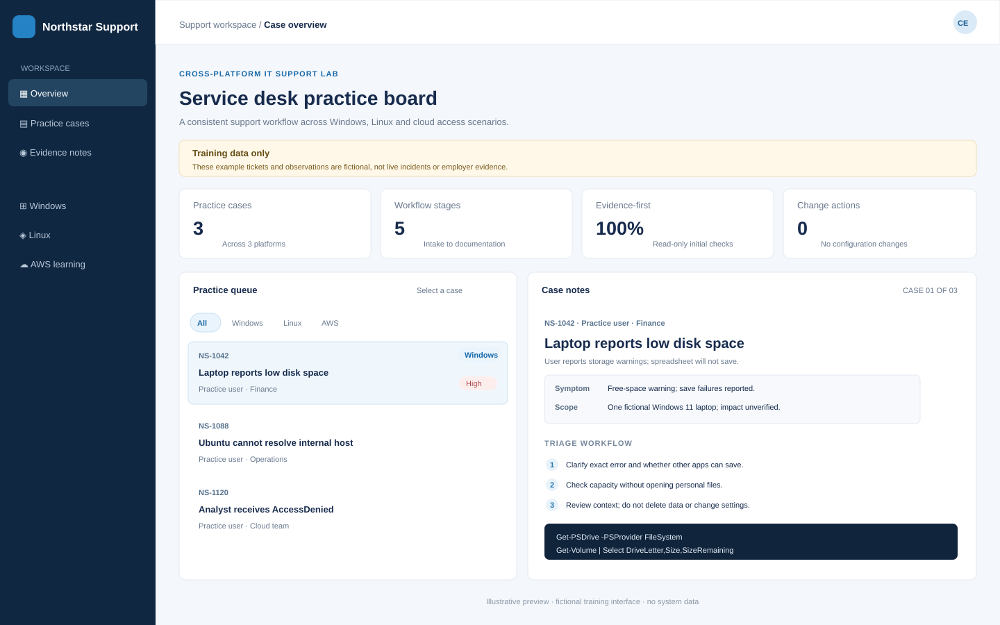
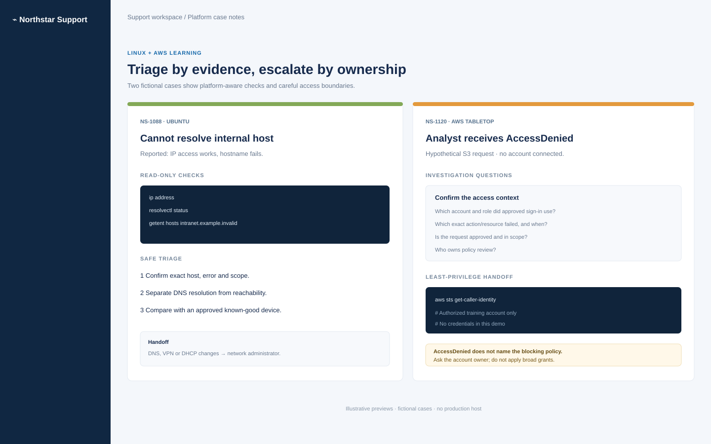

# Cross-platform IT Support Lab

A small practice project for entry-level Windows and Linux support, with an AWS access-troubleshooting case as the next learning direction. It combines an interactive ticket dashboard, evidence-first triage notes, safe command examples and interview prompts.

> **Status:** Portfolio training project. Tickets, people, systems and observations are fictional. No workplace incident or AWS account is represented.

## Screenshots

These illustrative dashboard previews use simulated training cases. They are not captures from a real service desk or customer system.

## Open the dashboard

Open `index.html` in a modern browser. It needs no build step, external libraries, analytics, network calls or sign-in. Select Windows, Linux or AWS to inspect the practice cases.

## Contents

- `index.html` — responsive interactive support queue with platform filters and case detail.
- `scenarios/practice-cases.md` — ticket briefs, triage, findings, handoffs and interview prompts.
- `scripts/windows-readonly-evidence.ps1` — read-only Windows information example.
- `scripts/linux-readonly-evidence.sh` — read-only Linux information example.
- `docs/interview-walkthrough.md` — concise interview framing and honest project boundaries.
- `screenshots/` — illustrative visual previews of the demo.

## Workflow

1. Clarify user impact and scope.
2. Collect relevant read-only information.
3. Separate a reported symptom from a verified observation.
4. Explain what the evidence does and does not show.
5. Escalate changes that require authorization or another team.
6. Record outcomes and protect sensitive information.

## Safety and privacy

The dashboard uses synthetic records and reserved example names. The scripts only read system information and print results. They do not change settings, delete data, install software, alter accounts, or contact AWS. Review commands and follow local policy before running them. Redact usernames, hostnames, addresses, account IDs, paths and other identifiers before sharing real diagnostics.

The AWS case is a tabletop. AWS examples are for an authorized lab only. The dashboard does not connect to AWS or use credentials.

## Interview demo

Open the page, select a case, and explain the process: clarify impact → gather evidence → assess scope → decide or escalate → document. State which details are simulated and what evidence a real incident would require. See [the walkthrough](docs/interview-walkthrough.md).

This project demonstrates lab practice, not professional production experience. Next steps: reproduce Windows and Ubuntu scenarios in isolated VMs, capture sanitized outputs, and later create an authorized AWS lab with least-privilege IAM and CloudTrail evidence.
